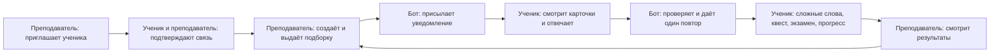
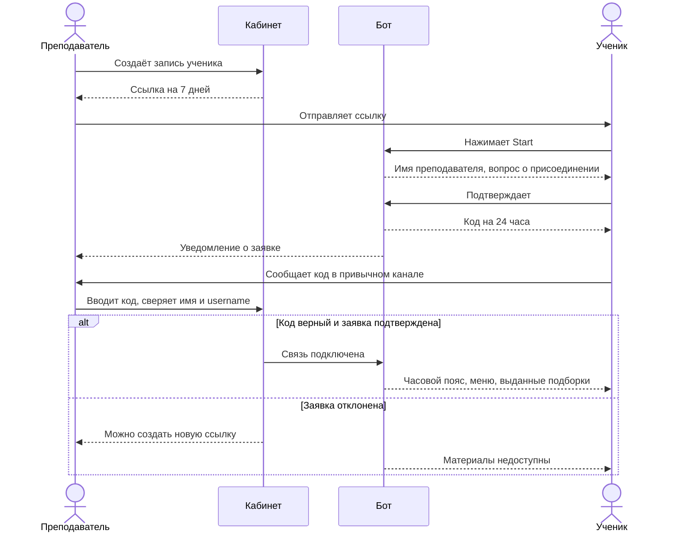
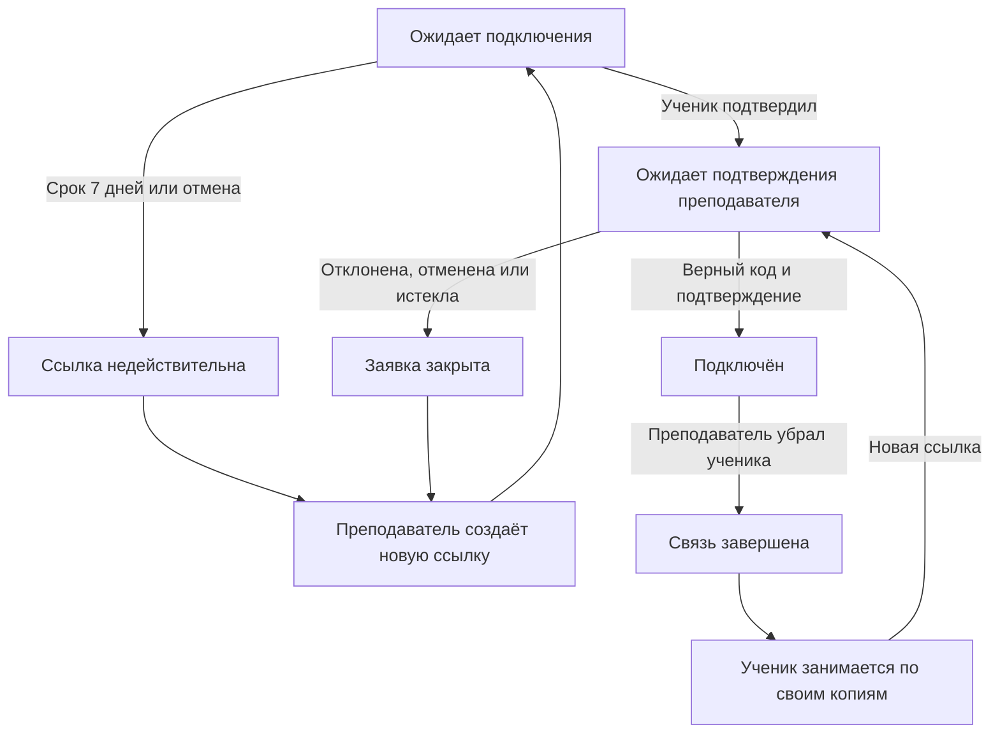
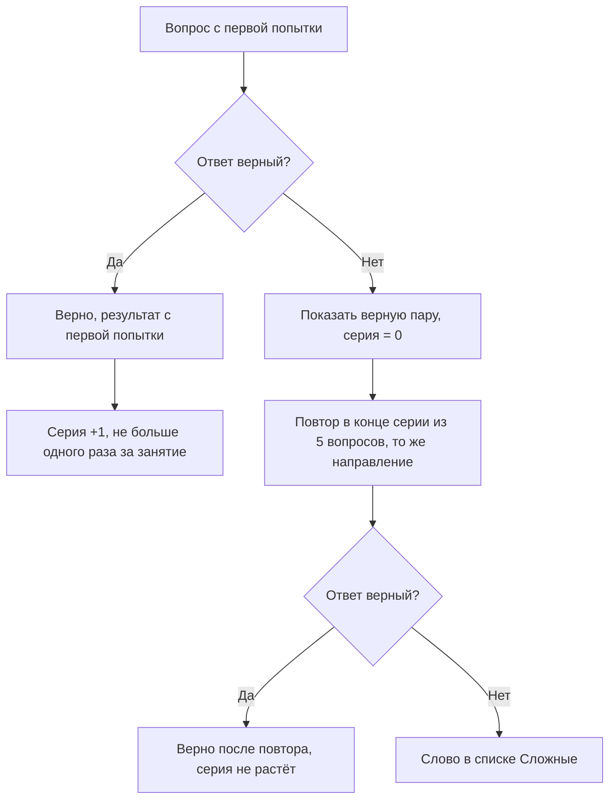
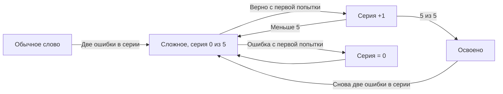
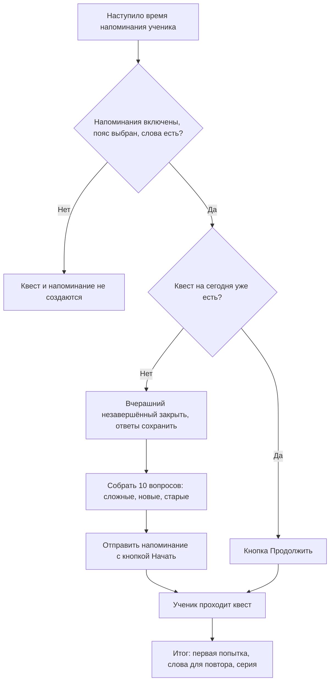
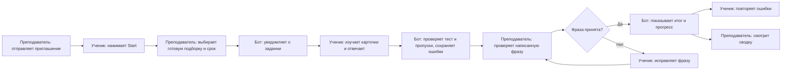
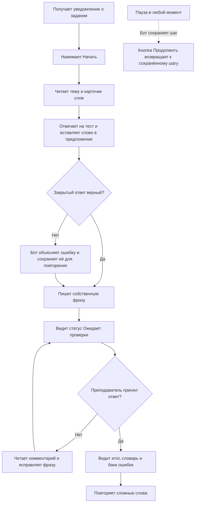

# Схемы сценариев Telegram-бота

Версия: 5 ноября 2026 года. Первая часть показывает актуальные процессы по [плану разработки](./План%20разработки%20Telegram-бота%20и%20веб-кабинета.md) и [сценарию](./Сценарий%20работы%20Telegram-бота%20—%20MVP.md). Вторая часть — архив прежней версии продукта, требованием не является.

# Актуальные схемы

## Общий цикл

## Привязка ученика

## Статусы заявки и связи

## Вопрос и вторая попытка

## Сложное слово

## Ежедневный квест

# Архив: прежний сценарий

Снимок прежней версии для [доски Miro](https://miro.com/app/board/uXjVEVYoKkc=/). Схемы ниже и доска не соответствуют новым требованиям: ручной проверки фраз, готовых подборок со сроком и письменной практики в первом релизе нет.

## Общий цикл

## Путь ученика

## Путь преподавателя

```mermaid
flowchart LR
    A["Получает доступ к роли преподавателя"] --> B["Приглашает ученика ссылкой"]
    B --> C["Выбирает готовую подборку, ученика и срок"]
    C --> D["Просматривает назначение и подтверждает"]
    D --> E{"Ученик нажал Start?"}
    E -- Нет --> F["Бот сохраняет назначение: Не подключён"]
    F --> G["Ученик нажимает Start"]
    G --> H["Бот уведомляет ученика о задании"]
    E -- Да --> H
    H --> I["Отслеживает: Назначено / В процессе / Сдано"]
    I --> J["Читает письменный ответ и результаты теста"]
    J --> K{"Ответ принят?"}
    K -- Нет --> L["Возвращает с комментарием"]
    L --> M["Ученик исправляет и отправляет снова"]
    M --> J
    K -- Да --> N["Бот сообщает ученику итог"]
    N --> O["Преподаватель смотрит сводку прогресса и ошибок"]
```

**Допущения MVP:** один преподаватель на ученика; преподаватель назначает подготовленные подборки; свободную фразу проверяет преподаватель. Создание уроков через бота, несколько преподавателей на одного ученика и отдельное управление группами требуют согласования.
